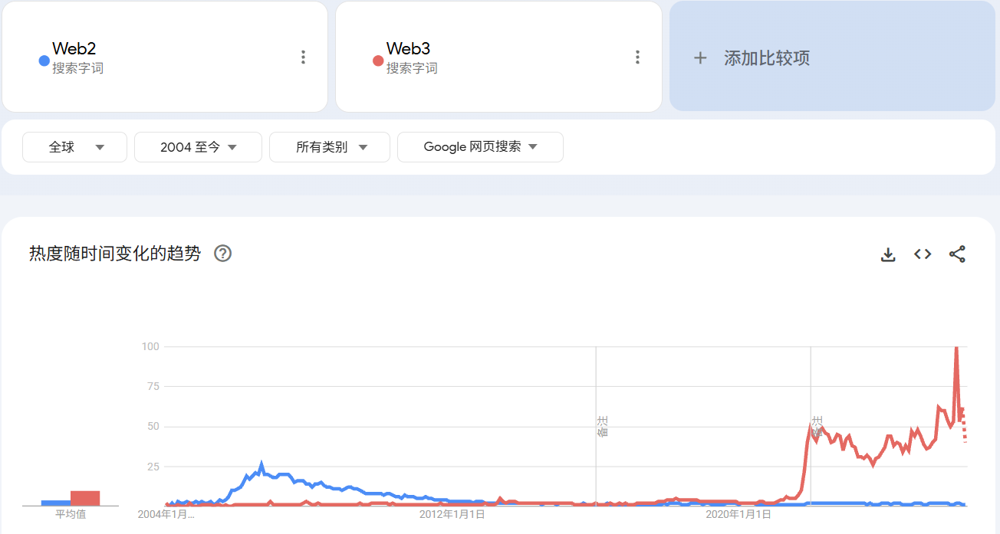
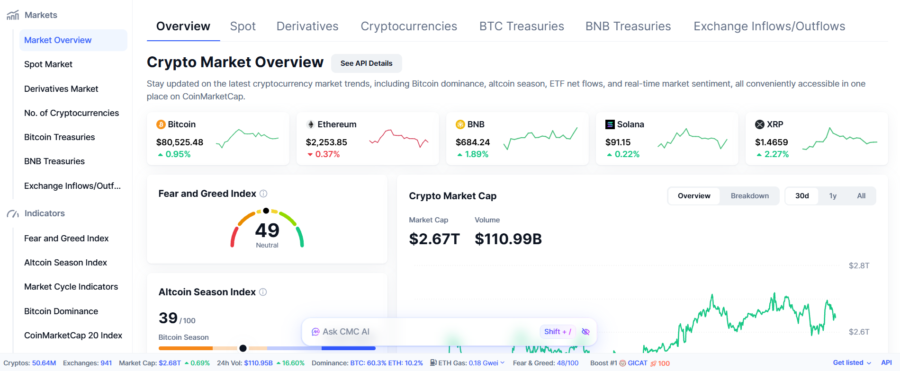
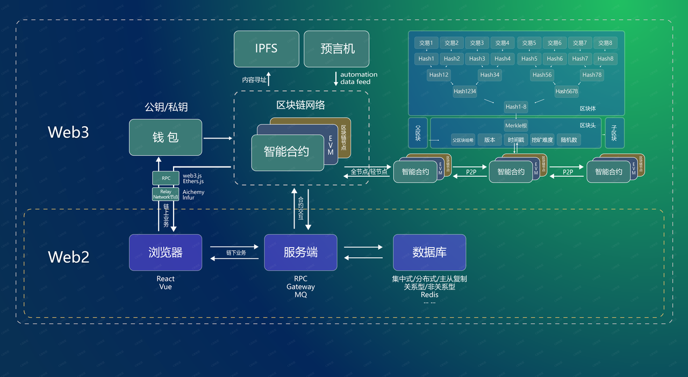
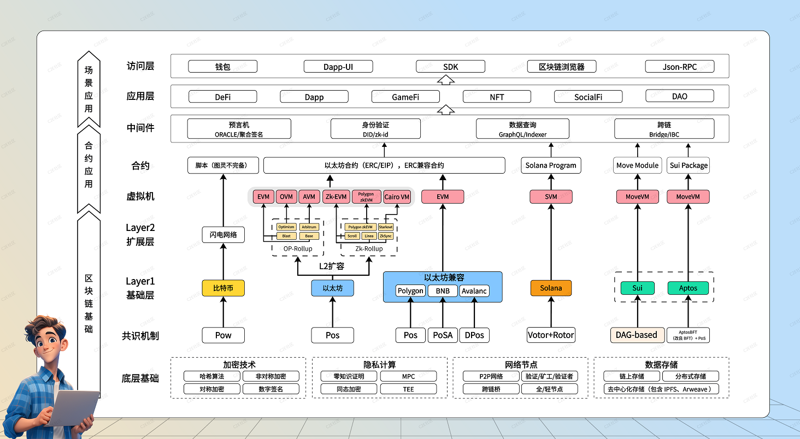
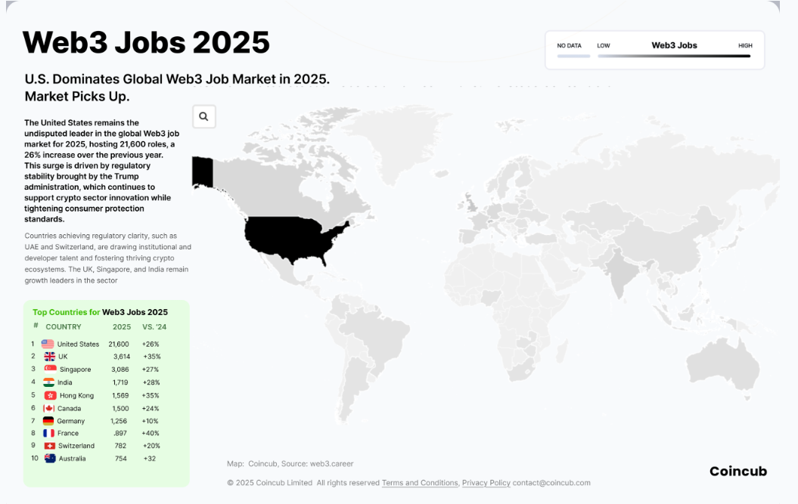
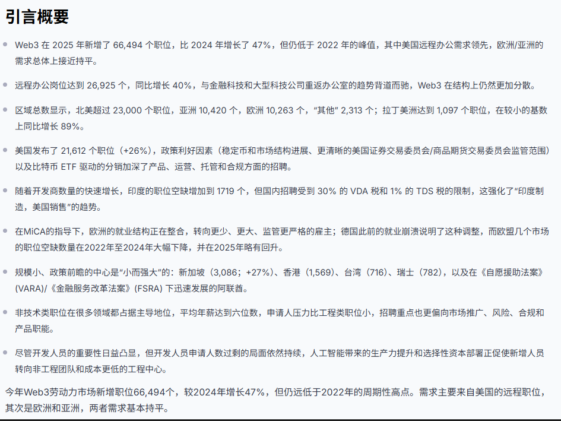
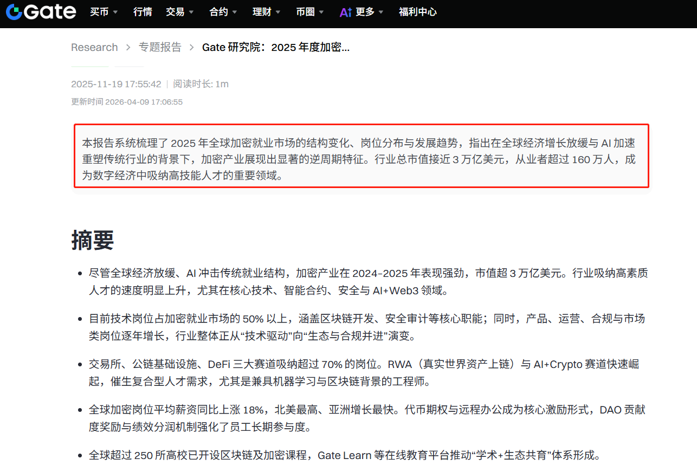
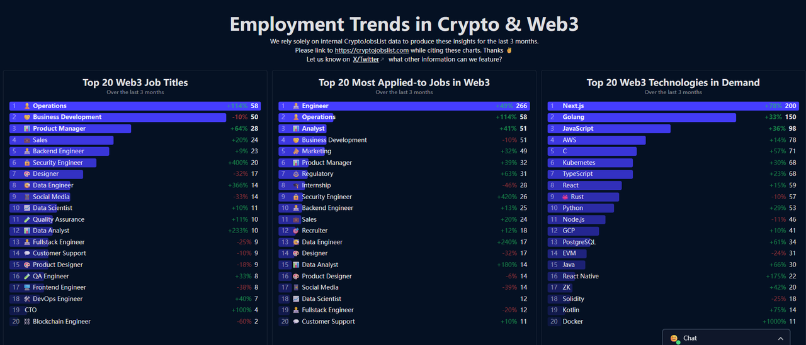
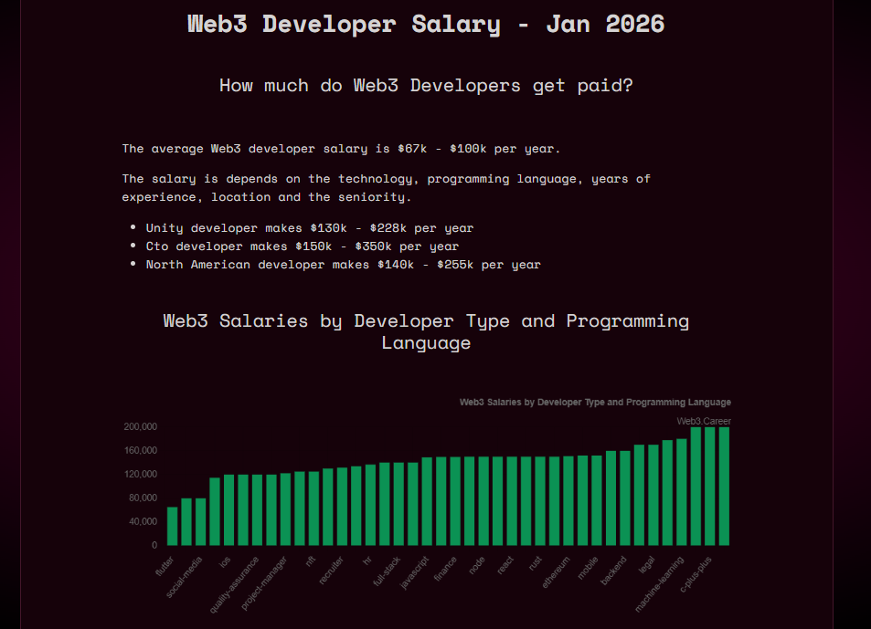

# 为什么Web3是程序员的破局出路

> 来源：https://kcno38rbm7bc.feishu.cn/wiki/YiL4wytRXiJEnPke3zEcgC6dnNh

# 为什么Web3是程序员的破局出路

**Web3行业分析**

这个板块内容比较细，文字表格对比偏多

不清楚的地方可以咨询主理人

将从以下5个角度来分析，给大家说明为啥这一行是大家可以选择的一个方向

 

## 一、热度市值分析

我们进行了一个Web2和web3的横向对比，图1红色线条走势为Web3热区曲线，蓝色为Web2

*图1-Google Trends【更新至2026.4】* 

**⭐结论一：Web3自2004-2019年底热度趋于低迷，2020年中下旬开始爆发**

**⭐结论二：2006年Web2热度到达顶峰，之后一路趋于平稳下降**

 

*图2-市值coinmarketcap【更新至2026.4】* 

**⭐结论三：现在整个Web3市值≈一个苹果公司≈全球新能源汽车行业≈英国一年GDP**

加密市值的长期韧性与增长潜力，说明这行**不是短期风口**，而是有**长期发展价值**的**，**近期虽然加密市值有所波动，但是不影响已经成熟的地基【BTC、ETH、SOL等生态】，它已经是全球顶级赛道了，当然很多兄弟和我们分享的时候聊币的内容，这其实不属于我们探讨范围，基本盘稳定且具有长期价值，有岗位就够了\~

 

 

## 二、政策分析

<sheet sheet-id="vIkMc6" token="DGjbsfmnmh9aqCtua54c7gvAn2d"></sheet>

*表1-香港区政策*

这里需要单独把【**中国香港**】拎出来，给大家梳理一下，这也是我们社区的大本营之一，这是一个“打造全球数字资产创新中心”为目标的城市，活跃着不少Web3圈子里的人，各种项目方以及交易所的负责人或者代表每年都会在此地进行**信息的交换**

 

<sheet sheet-id="QgQwIN" token="DGjbsfmnmh9aqCtua54c7gvAn2d"></sheet>

*表2-中国大陆及其他地区政策*

**⭐结论**  
中国香港：**双峰监管、牌照准入、合规开放，**连接传统金融与 Web3 的国际虚拟资产

中国大陆：**技术产业化放行、金融属性彻底隔离**，用行政禁令隔绝虚拟货币金融风险

欧盟：**立法先行、统一标准、牌照兜底**，加密资产已经纳入正规金融体系了

美国：**自由市场为主、司法执法兜底**，目前还没有统一立法，靠一些机构判例和诉讼监管的

新加坡：**小而精的合规中立模式**，凭借清晰的牌照制度，吸引了不少企业  

**❤C2E社区整理出处**

 

 

## 三、合规分析

<sheet sheet-id="HLz9B3" token="DGjbsfmnmh9aqCtua54c7gvAn2d"></sheet>

*表3-中国大陆及其他地区合规对比*

⭐**结论**

**中国做：中国香港合规持牌没有问题，大陆**可做联盟链 / 存证 / 无通证工具，不碰币

**出海做：**优先新加坡等东南亚国家，其次欧美

 

 

## 四、架构分析

对于我们很多刚入行的兄弟来说，好像入行Web3需要掌握很多新的内容

其实大家并不是从零来重构全新体系，Web3的架构逻辑是在原先 Web2 分布式、后端、安全等能力方面的延伸，大部分兄弟早期积累的技术完全可直接复用

 

**Web2 和 Web3 的架构区别**

(**❤提示**：可关注视频号、B站**程序员Web3社区获取视频讲解**)

*图3-Web2&Web3架构对比*

*图4-区块链架构应用场景*

<sheet sheet-id="q8OzIn" token="DGjbsfmnmh9aqCtua54c7gvAn2d"></sheet>

 *表4-Web2&Web3架构详细对照*

     我们在Web2干的时候，主要以【客户端 - 服务器】为模型，依赖的是云服务商与平台集中管理后端逻辑、数据存储和用户身份；数据、资产与价值分配都是由平台主导，用户是 “数据的生产者而非所有者”，存在单点故障与数据垄断的风险，但是在Web3，是以【区块链 + P2P 网络】来作为底层，智能合约来承载业务逻辑、链上账本来实现去中心化存储，钱包与 DID 取代平台账号，用户是可以拥有数据、资产的完全控制权的，并且价值由社区与用户共享，精辟一点总结如下

⭐结论

Web2 架构以【中心化服务器+平台垄断】为核心，价值是”**连接人与信息**”

Web3 架构以【去中心化区块链+分布式账本】为核心，价值是“**重构数据主权与价值流转**”

 

 

## 五、就业分析

前面这些问题解决之后，大家最为关心的这一行工作机会怎么样

我们前期探索的时候发现

市面上公开的就业报告是比较少的，这也是我们创建社区的意义之一

通过Web3社区这个媒介，去和行业圈子的开发者、运营者、大大小小的项目企业交流

才有一个比较客观的结论

前期的大部分的就业机会均是内部推荐为主，**就业岗位质量以及数量分析如下**

 

**岗位总量以及增长趋势**

*图6-Coincub《Web3 Jobs Report 2025》*

 

#### ⭐结论1

据*Coincub《Web3 Jobs Report 2025》显示，***2025年全球Web3领域新增岗位66,494个，较2024年反弹47%**，但仍低于 2022 年的峰值，其中**美国远程办公需求领先，欧洲/亚洲的需求总体上接近持平，远程办公岗位达到 26,925 个，同比增长 40%**，与金融科技和大型科技公司重返办公室的趋势背道而驰，Web3 在结构上仍然更加分散

*图6-Gate研究院《2025 年度加密就业市场报告》*

#### ⭐结论2

截至2025年底，**全球Web3行业从业者已超过160万人，行业总市值接近3万亿美元**，成为数字经济中吸纳高技能人才的重要领域，另外还有一些数据也能证实这行的就业规模在持续扩容，**Web3领域现有企业超2.9万家，过去一年新增岗位约10万个**（Web3 career）

 

大家有空可以去看看以上的几份报告，我这里就给大家**总的结论**

❤**逆周期增长：在全球金融科技领域重新招聘放缓的背景下，Web3岗位仍实现显著反弹，增速远超传统科技行业，尤其是远程岗位增长较为突出**  
  
**❤赛道较为集中：交易所、公链基础设施、DeFi三大赛道吸纳超过70%的岗位，是Web3就业的关键领域**

 

**❤薪资水平：Web3核心岗位平均薪资同比上涨18%，显著高于传统科技行业**

 

**Web3远程开发优劣势**

*图7-cryptojobslist*

#### ✔ 优势

- **不怎么卷，更容易拿Offer：**在有经验的情况下更好拿Offer，Web2目前全是经验怪背景怪，卷的不行，而Web3相对还好
- **学历要求不高：**更看中经验，当然了随着信息差缩小，现在头部交易所会有学历要求
- **年龄友好：**目前做远程的主力都是Web2转过来的，都是相对大龄一点的
- **薪资中位数高：** 即使比较初级的，拿到20k往上也是很轻松的，大部分两三年经验的都在25k～40k之间

 

#### ❌ 劣势

- 可能存在时差和英语问题，但是这类Offer通常薪资非常高，如果搞不定，大部分人都会选择**华人企业**
- 单份工作的稳定性可能比国内大公司要差一点，因为行业相对新和热，**初创公司**比较多，但也是因为初创，gov的补贴会非常多，**这些企业大多都不差钱**

*图8-Web3 career*

- 通过几轮周期的发展，目前区块链**行业在走向成熟**，也会不断革新互联网
- 数据上来看，过去一段时间，随着BTC减半完成，区块链岗位数量的增长，**同一岗位竞争人数明显下降。**相比两年前的熊市底部，已经进入了一个绝佳的入场时机
- 底层和应用技术的需求在最近这几年一直很旺盛，人才**供需关系**一直**不对等**

 

**近几年市场薪资情况**

(提示：移动端用户可以左右滑动查看完整信息）

<sheet sheet-id="YLx4G6" token="DGjbsfmnmh9aqCtua54c7gvAn2d"></sheet>

**注释**：

- 以上是北美远程标准
- 北美地区Onsite会比远程略高
- 其他地区远程岗位比北美远程略低

 

**以上数据都是市场公开的数据**

**那么目前我们C2E Labs接触到的的真实薪资具体是多少呢？**  
**下一个板块具体介绍**