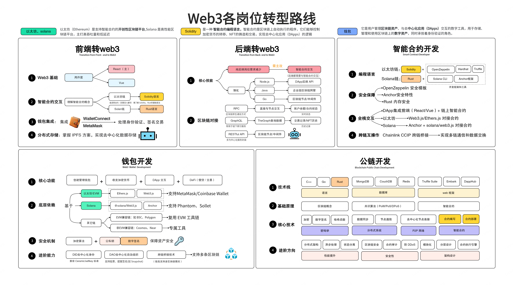
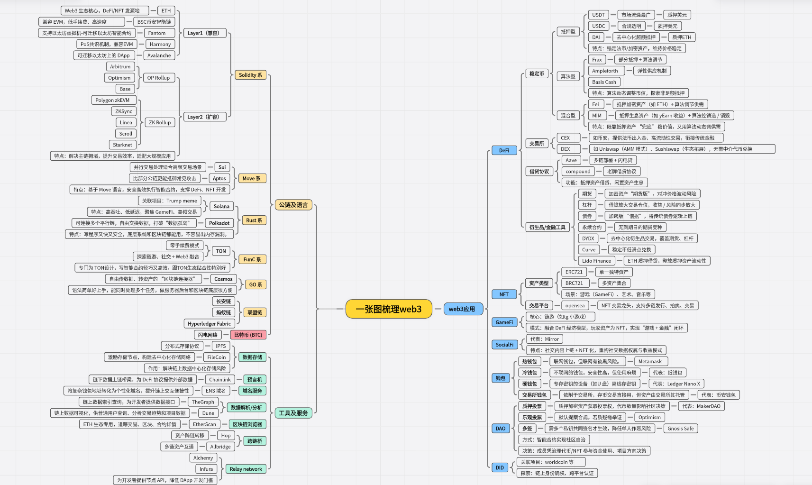

# Web3开发岗位选择

> 来源：https://kcno38rbm7bc.feishu.cn/wiki/CqEVwN6LoiS4NtkH8bncQJb5nWy

# Web3开发岗位选择

Web3开发岗位&技术栈  
  
通过之前架构的一个认识，那么我们现在适合在Web3具体做什么工作呢？目前主流的就是以下列举的岗位

❤**C2E社区技术整理→**

*图1-Web3各岗位转型路线*

 

- 智能合约开发工程师
- 智能合约审计工程师
- 全栈开发工程师
- DApp前端开发工程师
- 区块链后端工程师
- 区块链安全工程师
- 钱包开发工程师
- 公链(L1/L2/L3)开发工程师
- 投研分析师
- 公链研究员
- 区块链密码学研究员

 

具体岗位技术路线以及业务项目方向可查看****

*图2-Web3技术工具应用*

- **智能合约开发**：对于绝大多数开发兄弟来说，转型区块链开发，建议先学区块链技术原理集合智能合约，就业方向是智能合约开发
- **区块链前/后端开发**：如果具备web经验，比如前端、后端Go/Node/Java等，建议转区块链后端开发
- Java的解决方案：Java技术栈兄弟可以先用Java技术栈拆解区块链项目，然后直接去求职。工作中再切换其他语言。语言难度并不大
- 对于前端兄弟，如果原本不具备后端 Node 能力，那就学 DApp 前端，也够用
- **相对转型周期更长的技术栈**：C#、Android、iOS、Php、Python大数据、算法、运维开发

  - 直接转智能合约也可以，但是建议可以先补充点 web 开发能力，这样更好就业，这件事也可以通过我们训练营的资源来支持
  - 其次，你同时学习区块链基础课程和任务，包括智能合约相关课程并不冲突。只是在后续的项目实战阶段，会比较依赖你的web开发能力，否则项目任务很难完成

 

**❤温馨提示**

每个人擅长的方向以及工作积累的不一样

需要**结合自己实际情况**以及Web3目前的一个岗位情况来进行选择

看完这部分可以主动咨询发你手册的主理人**进行1V1的个性化梳理**

来决定哪一个岗位方向适合你