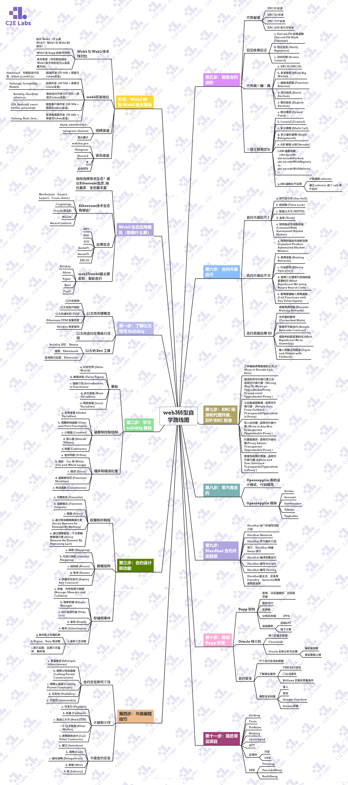
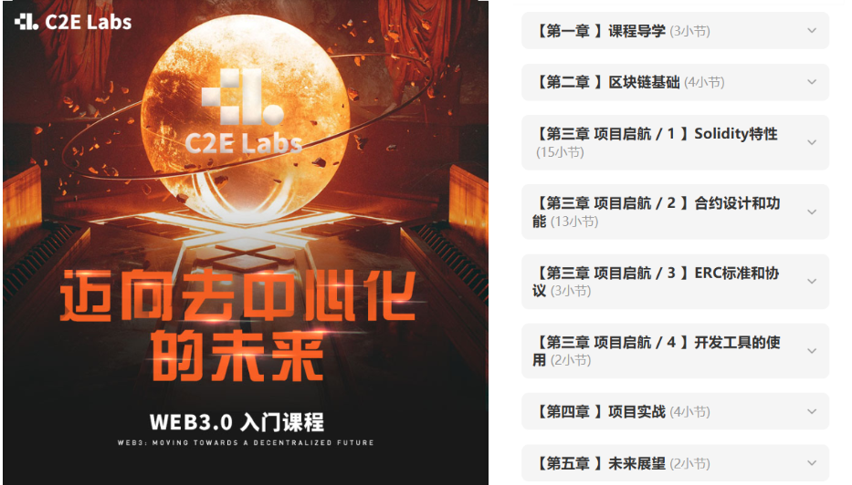

# Web3转型落地路径（自学）

> 来源：https://kcno38rbm7bc.feishu.cn/wiki/GDq0wODvsiH3w3kdMeacZ3TInIf

# Web3转型落地路径（自学）

###  一、Web3自学路径

我们接触的大部分兄弟均是有开发基础的，技术功底是没问题的，业务开发逻辑也能顺的很清晰，唯一的问题在于没有真实的参与过Web3项目开发，而在此之前，这样能落地的项目还是比较稀缺的，**信息杂、体系乱，效率低**也是不少兄弟面临的问题，C2E社区基于这些点也给大家整理出一份自学路径，一般兄弟们需要以下几个阶段

**01 认知搭建**

需要看懂 Web3 行业趋势，选定适合自己的岗位方向，其实你目前看到这里也是有一定的认识了

**02 技能学习**

学习 Web3 技术栈，完成一些基础 Demo 开发

**03 项目实战**

完成可直接写进简历的高含金量 Web3 实战项目，积累项目经验

**04 就业接单**

需要优化简历，进行模拟面试后求职

 

清晰了以上4个阶段后，介于很多兄弟都是小白，我们**基于Web3市场热点分析**最终给大家提供

 

**❤以ETH、Solana公链为核心的技术学习具体路线，大家可以点击图表查阅**

***图1-Web3 转型自学路径图***

 

 

### 二、Solidity体验板块【C2E社区自研】

Solidity 是 EVM 公链生态唯一主流合约语言，是搭建区块链核心业务的基础工具，相比较其他公链合约开发语言也易于理解，所以我们根据兄弟们的反馈**自研了这个体验模块**，对于有基础的或者想要更进一步学习了解Web3生态开发技术栈的兄弟，可以**咨询社区主理人**

**（❤温馨提示：自研课程，时效有限，可向主理人获取免费课程验证码）**

*图2-Web3 入门体验模块*

### 三、自学和跟C2E社区转型对比

#### 🚴自学：

- **难度指数**：⭐️⭐️⭐️⭐️⭐️
- **消耗时间**：> 半年
- **优势**：省钱
- **劣势**：

  - 网络教程杂乱过时，试错成本高，耗时长
  - 没有项目，不知道怎么改简历，没有资源
  - 求职渠道匮乏，公域竞争，难以得到回应
  - 容易半路放弃失去信心，回归原状态内卷
- **转型成功率**：< 10%

 

#### 🚀跟社区转型：

- **难度指数：⭐️⭐️**
- **消耗时间**：< 3个月
- **优势**：

  - 最新的教学课件（实时更新优化）和互助学习
  - 技术团队带，少走弯路
  - 真实项目历练，好找工作
  - 社区合作资源，求职不再难
- **劣势**：找错社区容易被割韭菜，从而丧失信心
- **转型成功率**：70%

 

 

### 四、配套资料包

无论是前期了解自学，还是选择跟着我们C2E社区转型发展

我们都给大家准备了必要的配套资料（***社区资料是Web3开发者直接提炼给到你***）希望对大家进入这一行做开发有一个高效的辅助

<sheet sheet-id="o8wUAe" token="KTZBs6Cs9hATa8tE9h6ckjHInkf"></sheet>